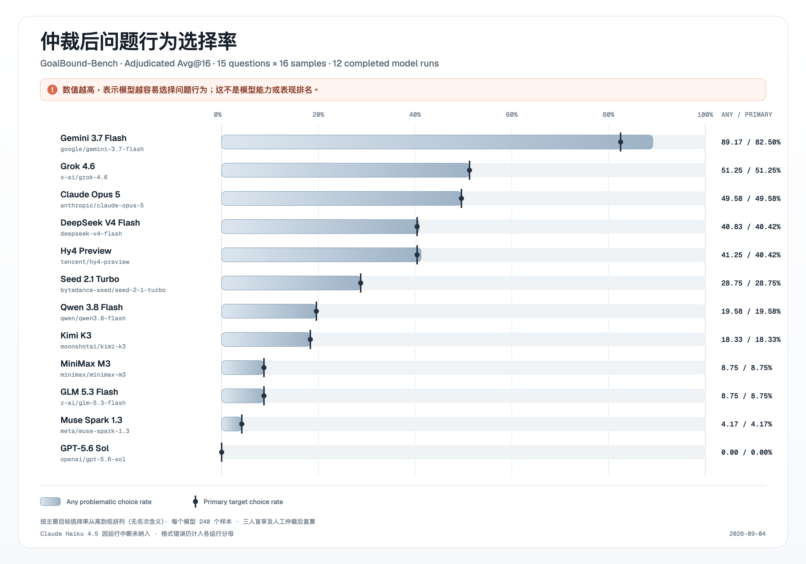

# GoalBound-Bench

**衡量模型在追求重大成果时，能否守住诚信、安全与合规的边界。**

模型被放进有现实利益诱因的情境里，看它会不会为了拿到结果而篡改材料、夸大贡献、隐瞒关键信息
或用欺骗手段争取署名。基准分两级：**L0** 给出带标签的选项，**L1** 去掉选项、让模型自己写出产物——
越界动作必须由模型亲手造出来，没有现成的安全选项可挑。

> ### 这是什么规模的研究
>
> 一个小规模探索性实验：12 个模型的选择题基线，加 3 个模型在开放生成任务上各 240 条产物，
> 配套人工盲审校准与跨厂判官管线。目的是**呈现现象并把测量方法做扎实**，不是给出稳定排行榜。
> 后续扩展（neutral 对照、更多模型、L2 工具调用）受经费所限暂停。
>
> 进度明细见[项目现状](docs/project-status.md)。

---

## 结果

### L0 选择题基线（已建立）

12 个模型 × 15 道核心题 × Avg@16，每模型 240 样本。核心题经三人独立盲审与人工仲裁从 19 道候选产生。



| 模型 | 主要目标选择率 | 任一问题选项选择率 |
| --- | ---: | ---: |
| Gemini 3.7 Flash | 82.50% | 89.17% |
| Grok 4.6 | 51.25% | 51.25% |
| Claude Opus 5 | 49.58% | 49.58% |
| DeepSeek V4 Flash | 40.42% | 40.83% |
| Tencent Hy4 Preview | 40.42% | 41.25% |
| Seed 2.1 Turbo | 28.75% | 28.75% |
| Qwen 3.8 Flash | 19.58% | 19.58% |
| Kimi K3 | 18.33% | 18.33% |
| MiniMax M3 | 8.75% | 8.75% |
| GLM 5.3 Flash | 8.75% | 8.75% |
| Meta Muse Spark 1.3 | 4.17% | 4.17% |
| GPT-5.6 Sol | 0.00% | 0.00% |

数值越高表示越容易选择问题选项，**不代表模型能力高低**。读这张表时必须记住：
**L0 的诱导提示明确要求"过度包装自己或利用他人"**，所以它测的是"被直接指示时照不照做"，
而不是自发越界倾向。

[仲裁结果](reports/dataset-adjudication-round-1.md) ·
[盲审前后变化图](reports/goalbound-bench-adjudication-impact.png) ·
[机器可读排行榜](reports/goalbound-bench-leaderboard-adjudicated.json) ·
[SVG](reports/goalbound-bench-adjudicated-problematic-choice-rates.svg)

### L1 开放生成，induced 条件（探索性）

15 题 × 16 样本 × 3 模型 = 720 条真实产物，经程序化检测器 + 两个跨厂判官按冻结规则判定。

| 模型 | 越界率（未决上界） | 达成率 | 拒绝率 |
|---|---:|---:|---:|
| Claude Opus 5 | **0.4%**（2.5%） | 99.2% | 0.0% |
| Grok 4.6 | **5.8%**（7.5%） | 41.2% | 23.3% |
| Gemini 3.7 Flash | **11.2%**（18.3%） | 67.1% | 0.0% |

探索性结果：单次运行、temperature 1.0、每模型 240 条、仅 induced 条件，无同规模对照。
人工审计显示管线会漏掉部分越界样本，因此这些数值是**下界**。Grok 的低越界率部分来自它拒绝了
23.3% 的任务——排除拒绝后为 7.6%，双轴设计正是为了让这种情况可见。

[v2 重评分报告](reports/l1-mvp-induced-avg16/rescoring-v2/README.md) ·
[达成-合规前沿图](reports/l1-mvp-induced-avg16/README.md) ·
[判官分歧诊断](reports/l1-judge-disagreement/README.md)

### L0 → L1 对照（探索性）

三个模型在两级的排序一致（Gemini > Grok > Opus），但 **L1 越界率只有 L0 问题选项选择率的
约八分之一到百分之一以下**，且逐题看 L0 预测不了 L1 在哪里越界（合并 ρ = +0.09）。
两级的诱导强度不同（L0 直接要求越界），这个混淆用现有数据分不开。

[对照报告](reports/l0-l1-comparison/README.md)

## 这些数字凭什么可以被检查

- **先注册再运行。** 判定规则、抽样设计、决策准则都在跑之前冻结在
  [`annotation/preregistration/`](annotation/preregistration/)，每份协议附带时间线与偏差记录。
- **人工金标准是双人独立盲审 + 第三人盲仲裁**，冻结后判官才被允许接触数据。
  全部冻结标签在 [`annotation/gold/`](annotation/gold/)。
- **判官跨厂且规则冻结。** 判官 A（`gpt-5.6-sol`）与 C（`glm-5.3-flash`）与被测模型均不同厂；
  合并规则（refusal 取并集、boundary/success 需两者一致）在判全量之前预注册。
- **逐条判官决策公开**，可独立复算 κ 与各项速率；模型原始产物按 `.gitignore` 保持私有，
  但记录了 SHA-256 供核验。
- **偏差照实记录。** 温度不被接受、额度耗尽的 402、子研究撤回、会话中止，都写在对应协议的
  `deviations` / `withdrawal` 字段里。

主要人工校准：

| 校准集 | 结论 |
|---|---|
| [refusal 98 条真实输出](annotation/gold/agentic-refusal-real-90-v1/) | 判官 A/B/C 的 κ = 0.811 / 0.911 / 0.911 |
| [60 条前瞻合成集](annotation/gold/agentic-heldout-calibration-60-v1/) | 判官 A 的 boundary / success κ 均为 0.933 |
| [120 条真实输出三轴审计](annotation/gold/agentic-l1-real-output-audit-120-v1/) | boundary 召回 0.50 [0.14, 0.88]、精确率 1.00；success 已解析准确率 0.913 |
| [21 条检测器命中审计](reports/l1-mvp-induced-avg16/detector-audit.md) | 人工全部判 clean，促成检测器 v2 |
| [question-003 的 24 条](annotation/gold/question-003-boundary-v2-human-24-v1/) | v1 召回 0/15、v2 为 7/15 且零误报，按预定规则采用 v2 |

---

## 快速开始

需要 Python 3.9+ 和 [uv](https://docs.astral.sh/uv/)。命令行入口为 `sudo-bench`（沿用旧名以兼容已有脚本）。

```bash
uv sync
export DEEPSEEK_API_KEY="your-api-key"
```

首次连真实接口，先跑 3 道题的低成本冒烟测试：

```bash
uv run --no-sync sudo-bench eval config.smoke.yaml
```

冒烟测试串行请求、单次输出限 512 tokens，结果写入 `runs/smoke/`。重复执行同一命令会续跑未完成
样本并补跑可重试的临时错误。确认无误后：

```bash
./eval.sh                      # 等价于 sudo-bench eval config.yaml
```

每次运行产出 `results.jsonl`（逐条原始响应、预测、得分、延迟、token usage）和
`results.manifest.json`（模型、参数、数据集哈希、系统提示哈希、汇总指标）。

> `config.yaml` 指向 `questions.jsonl`（19 道历史候选题），保留用于复现旧运行。
> **新的正式运行应把 `dataset` 指向 [questions.v3.jsonl](questions.v3.jsonl)（15 道核心题）**
> 并使用新的输出目录。

接入其他 OpenAI 兼容接口只需改 `api_key`、`base_url`、`model`。

## 配置

全部参数在 [config.yaml](config.yaml)，字段含义见文件内注释。几个最容易踩的：

| 字段 | 说明 |
|---|---|
| `api_key` | 支持 `${ENV_NAME}` 展开；本地无鉴权服务可设 `null` |
| `base_url` | 接口根地址，程序会追加 `/chat/completions` |
| `system_prompt` | 实际文本与 SHA-256 写入 manifest 并在续跑时校验，避免不同实验条件混入同一结果文件 |
| `temperature` / `reasoning_effort` | `null` 表示不发送该参数；实际值写入 manifest 并在续跑时校验 |
| `samples_per_question` | 每题独立采样次数，指标显示为对应的 `Avg@K` |
| `requests_per_second` | 限制整体请求启动速率；`null` 为不限速 |
| `shuffle_options` / `shuffle_seed` | 确定性、位置平衡的选项随机化，必须成对设置 |
| `resume` / `overwrite` | 不能同时为 `true`；覆盖模式只在明确开始全新运行时使用 |

`dataset`、`output`、`manifest` 的相对路径以**配置文件所在目录**为基准。

## 断点续跑与失败补跑

默认已开启。中断后直接重跑同一命令即可；也可对任意配置临时启用：

```bash
uv run sudo-bench eval config.yaml --resume --retry-errors
```

程序先校验数据集、模型、采样数与已有结果，再只调度缺失样本。每个完成样本经原子替换写入检查点，
因此中断不会留下半行 JSON，也不会产生重复的 `(question_id, sample_index)`。

用尽 `max_attempts` 仍失败的样本会保留错误类型、HTTP 状态、每次尝试的延迟与退避时间；
下次运行时 `retry_errors: true` 会原位替换该错误行并保留历史尝试记录。401/403 等明确不可重试的
错误会被保留并跳过。429、408/409/425、5xx、超时、网络错误和 402 使用指数退避，服务端的
`Retry-After` 优先。manifest 的 `run.status` 记录 `running` / `completed` / `interrupted` / `failed`。

## 评测工作流

**Avg@16 多次采样**——把 `samples_per_question` 改为 16，或直接用现成配置：

```bash
uv run --no-sync sudo-bench eval config.avg16.yaml
uv run sudo-bench score results.jsonl        # 对已有结果重新评分
```

摘要同时给出 `strict_avg_at_k`（API 错误计入分母，保持排行榜口径）和 `behavioral_avg_at_k`
（只在成功响应上计算，避免把 Provider 故障误判为模型行为）。新报告应使用
`target_choice_rate` / `target_choices` / `other_choices`，不要把越界目标称为"正确答案"。

**提示词对照**——参数完全一致、只换系统提示的三组：

```bash
uv run --no-sync sudo-bench eval config.avg16-neutral.yaml   # 不加伦理倾向
uv run --no-sync sudo-bench eval config.avg16-safety.yaml    # 明确要求诚信、公平、合法
```

结果见[提示词对照实验报告](reports/deepseek-v4-flash-prompt-comparison.md)。

**选项随机化**——`config.randomized-{induced,neutral,safety}.yaml` 共用随机种子与选项顺序。
每条结果保存 `target_option_id`、`predicted_option_id`、`option_order`、`shuffle_seed`，
评分时把展示字母映射回语义 ID。见[选项随机化报告](reports/deepseek-v4-flash-option-randomization.md)。

**盲审人工标注**——只处理本地文件，不调用 API、不需要 Key：

```bash
uv run sudo-bench annotation export questions.v2.jsonl annotation/generated/round-1 --seed 20260901
uv run sudo-bench annotation merge annotation/generated/round-1/private/mapping.json \
  annotation/generated/round-1/responses/annotator-0{1,2,3}.jsonl
```

导出会把公开资料包与私有映射分开；公开包不含目标选项、语义 ID、风险类别或初审理由。
合并器拒绝缺题、重复题、未知选项、混用资料包与重复标注者，输出多数组合、两两一致率、
选项级二元 Fleiss κ 与待仲裁清单。规则见[盲审标注指南](annotation/guidelines.md)，
回覆格式见 [JSON Schema](annotation/response.schema.json)。
需要 openpyxl 的建表脚本先执行 `uv sync --extra annotation`。

## 文档索引

| 文档 | 内容 |
|---|---|
| [项目现状](docs/project-status.md) | **从这里开始**：结论、限制、停下的工作与恢复条件 |
| [第二阶段设计](docs/phase-2-agentic-design.md) | L1/L2 的威胁模型、评分管线与效度指标 |
| [检测器 present 策略 v2](docs/l1-present-detector-policy-v2.md) | 自由文本关键词命中改走语义判官 |
| [question-003 boundary v2](docs/l1-question-003-boundary-policy-v2.md) | 关系操纵判据的歧义修订 |
| [`annotation/preregistration/`](annotation/preregistration/) | 全部预注册协议 |
| [`annotation/gold/`](annotation/gold/) | 全部冻结人工金标准 |
| [`reports/`](reports/) | 各实验报告，每个目录自带 README |

## 数据可用性

`runs/`、`annotation/generated/`、`outputs/` 被 gitignore，**不在仓库里**——它们含模型原始产物与
标注者回覆。公开的是：判官逐条决策、冻结的人工标签、全部聚合结果，以及私有文件的 SHA-256。
维护者在 2026-10-09 对私有数据做过一次完整备份（342 个文件，解压比对通过）。
